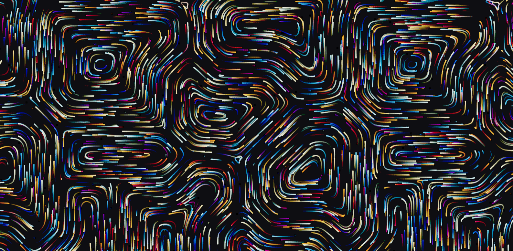

# voronoi FLow

- 使用纹理或手动构造距离场,计算距离场扩散方向的切向方向得到粒子速度方向
- tsl计算节点更新位置
- hash() 随机颜色
- AfterImage后处理来产生拖尾
- 正交相机zoom放大覆盖整个屏幕,我没有适配屏幕比例,只是按照自己的屏幕大小来放大的

## glsl version
[voronoiFlow](https://www.shadertoy.com/view/fffyDB)